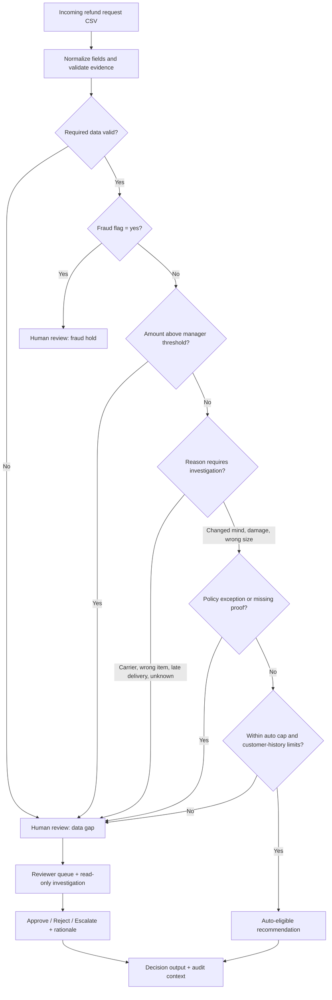
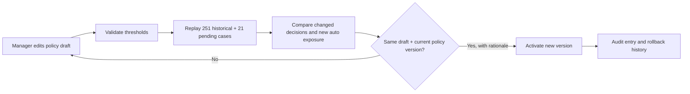

# RefundOps AI | Windward Applied AI Engineer Home Assignment

**Submission scope:** a conservative refund decision engine, connected reviewer and policy-manager workflows, tests, historical replay, and one unified white Studio experience connected to the Python API. This is a sandbox: no real refunds are executed.

## Start in one command

Requires Python 3.10+ and an internet connection on first run to install dependencies. From the repository root:

```bash
./run.sh
```

Open `http://127.0.0.1:8000/experience` for the **white RefundOps Studio connected product**. Its queue, decisions, policy replay and audit are backed by the Python API and engine.

To run a new CSV with the same columns:

```bash
./run_csv.sh /path/to/new.csv /path/to/decisions.csv
```

To run tests:

```bash
python3 -m pytest -q
```

## One demo: connected RefundOps Studio

The **single product demo** is `product/experience/index.html`, served by FastAPI at `http://127.0.0.1:8000/experience` after `./run.sh`. Reviewer actions, policy replay and audit use the Python API. The legacy dark Streamlit `product/app.py` is not the primary experience. The 4:12 video below is a recording of this same product, not a second demo. It is a screenshot-based walkthrough rather than a continuous screen recording.

## Demo for business users

**Watch the connected demo:** [4:12 white-UI walkthrough video](recording/RefundOps_White_Studio_Demo.mp4). The recording uses the local API through a browser bridge because direct localhost browser navigation is restricted in the recording environment.

- **Connected white Studio (primary evidence):** `./run.sh`, then `/experience`. Show reviewer queue, investigation, decision with rationale, manager policy draft, historical replay and activation.
- **Presentation:** `slides/RefundOps_AI_Executive_Pitch.pdf` (8 slides).
- **Solution design:** `docs/RefundOps_AI_Solution_Design.pdf`.
- **Requirement audit:** `REQUIREMENTS_AUDIT.md`.

## How a refund decision is made

The engine is **rules-based**, not an LLM making payment decisions. An `approve` result means **eligible for automatic approval in this sandbox**, not that money was transferred.



### Decision boundary: default demo policy

| Check, in priority order | Automatic recommendation | Human-review trigger |
|---|---|---|
| Input quality | Valid positive amount, known fraud status and relevant fields | Missing/invalid fields or unknown fraud status |
| Fraud | **Never** auto-approve a fraud-flagged case | Any `fraud_flag=yes`, including a note claiming confirmation |
| High amount | Amount ≤ **$300** manager threshold | Above $300 |
| Request reason | Supported low-risk cases (`wrong_size`, eligible `changed_mind`, eligible `arrived_damaged`) | Never arrived, late delivery, wrong item, unsupported reason |
| Time / evidence | Change of mind within **14 days**; damage above **$50** needs photo evidence review | Outside window, missing delivery age, or unverified photo note |
| Auto cohort | Amount ≤ **$50**, tenure ≥ **6 months**, prior refunds in 12 months ≤ **1** | Any limit exceeded or history missing |

The **$50 / 6-month / 1-refund** cohort is a conservative *design assumption* for this exercise, not a rule established by the source policy notes. The $300 manager threshold is an assignment example implemented as a configurable default. A support-note keyword is **not verified evidence**. Cases requiring external confirmation stay in human review.

**Worked examples** (default policy):

- **$25, wrong size, 24-month customer, no prior refunds, no fraud** → `approve` / `LOW_RISK` (recommendation only).
- **$320, any otherwise eligible reason** → `review` / `HIGH_AMOUNT` (manager threshold).
- **$25, fraud flag yes, note says “fraud team confirmed”** → `review` / `FRAUD_HOLD` (untrusted note cannot override hold).
- **$55, damaged item, no verified photo** → `review` / `PHOTO_REQUIRED`.

### Manager changes: preview before publish



The preview shows **counterfactual classifications**, not proven savings or safety. Activation requires an exact matching preview and a written rationale. Unsafe free-text-based fraud/warehouse auto-approval switches are rejected; the decision engine also fails closed if they are passed directly. Reviewer actions are stored in local demo state, **not** executed as payments. A real launch requires independently verified fraud/warehouse evidence, payment controls, immutable audit storage, outcome monitoring and rollback triggers.

## Architecture

CSV -> normalization -> deterministic, versioned policy engine -> auto-eligible OR prioritized human review. A bounded read-only investigation workflow retrieves evidence and provides an auditable trace. Reviewer actions and manager policy changes run through the local FastAPI service; historical replay uses the same engine. No payment calls. See `docs/ARCHITECTURE.md`.

## AI usage and API key

**No live LLM is used in the current executable system.** This is intentional: financial eligibility, fraud holds and policy enforcement must be deterministic and testable. The optional proposed LLM evidence extractor would use GPT-4.1 mini for structured free-text extraction, never for authorizing payments. Set `OPENAI_API_KEY` server-side if implementing that deferred module; the shipped code does not read or need an API key. Cost estimates in the design document are planning assumptions, not verified current provider prices. No empirical LLM evaluation is claimed.

## AI coding tools reflection

AI-assisted code generation was used for the UI, engine, tests and documentation. One AI-suggested shortcut to auto-approve fraud cases on the basis of a free-text phrase such as “fraud team confirmed” was **rejected for production**: untrusted notes cannot establish authenticated approval. The connected API blocks these unsafe auto-approval toggles. The work was checked against source CSVs, automated tests and replay.

## Evaluation and limitations

21 pending: 3 auto-eligible / 18 review. 251 historical: 84 auto-eligible / 167 review. Historical agreement is **not** proof of financial safety, model accuracy or causality. A labeled holdout, shadow-mode evaluation and production outcomes monitoring are required before enabling money movement. No authentication, production audit store, live LLM, payment integration or deployment is claimed.

## QA verification

Automated tests pass from the repository root (see CI for the current count). A reviewer cannot approve a fraud-flagged case in the API, repeated decisions are blocked, and activating a policy requires an exact current-version historical preview. The CLI supports caller-relative CSV paths. See `QA_REPORT.md`.

## Submission completeness

**Repository:** https://github.com/Or04/refundops-ai. **Screen recording:** `recording/RefundOps_White_Studio_Demo.mp4` is a silent 4:12 screenshot-based walkthrough with captions of the connected FastAPI-backed demo. It is not a continuous screen recording. The video is included as a fallback for reviewers who cannot run the app. No actual payment is processed.
