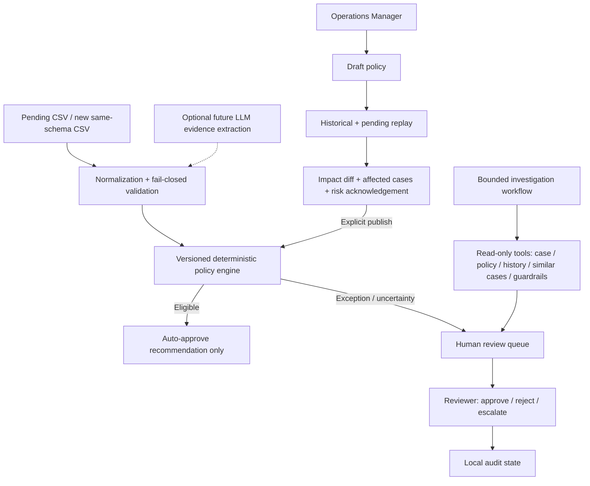

# System Architecture & Trust Boundaries

## Architecture diagram

## Component map
- `engine.py`: sole deterministic decision function, `decide()` and `batch()`; no money movement.
- `cli.py`: batch processing on a new same-schema CSV; produces a decisions CSV.
- `app.py`: Streamlit reviewer + policy manager UI; one-command demo.
- `api.py` + `experience/index.html`: connected local API experience, bounded read-only investigation trace.
- `RefundOps_Studio_Demo.html`: offline visual product demo; local browser simulation, not wired to backend.
- `tests/`: engine, API and agent workflow tests.

## Agentic design: current vs proposed
**Implemented:** a bounded, deterministic five-tool investigation workflow, evidence gaps, policy-grounded rationale, human handoff. **Not implemented:** autonomous LLM tool selection, semantic retrieval, production memory or live model calls. Proposed future orchestrator coordinates Investigation, Policy and Risk specialists, each with scoped tools and structured outputs; all financial actions remain gated by the deterministic engine and human approval.

## Safety boundaries
- Fraud flags are human/fraud-team review by default, including small amounts.
- Missing fields, unsupported reasons and unverifiable evidence fail closed to review.
- The $50 auto cap, six-month tenure and <=1 prior refund are conservative *design assumptions*, not explicit policy-note rules.
- $300 manager review cap is a demo configuration based on the assignment example.
- Text containing 'photo attached' is not independent image verification; no live payment, carrier, fraud or warehouse integrations.
- Policy preview is a counterfactual replay, not causal outcome prediction. History includes noisy decisions.
- Local state/audit is not durable production logging; require immutable event log, RBAC, dual control and idempotent payment service before deployment.
